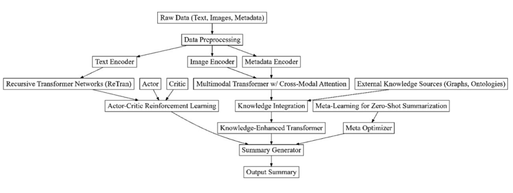

<div align="center">

# Phase 2 · Low-Resource Summarization

### Exploring Malayalam headline generation and multimodal document summaries.

**PyTorch Transformer · Malayalam NLP · January 2025 research proposal**

[Project showcase](#project-showcase) · [Implemented model](#implemented-model) · [Research direction](#research-direction) · [Getting started](#getting-started)

</div>

This repository brings together the available Phase 2 summarization materials: a **Malayalam news-to-headline Transformer implementation**, a broader **multimodal multi-document summarization proposal**, and early dataset exploration.

The research direction focused on summarization for low-resource Dravidian languages. The recovered code is a narrower, text-only Malayalam experiment; it does not implement every component shown in the proposal diagrams.

## Project showcase

### The research vision

The January 2025 review proposed bringing text, images, and metadata into a common summarization workflow, with external knowledge and iterative feedback. The diagram below is an original proposal figure recovered from the review slides.

<p align="center">
  
</p>

**Proposal figure, not an executed pipeline.** Personal identifiers and slide footers were excluded from the extracted figure.

### The implementation available today

The code trains a custom encoder–decoder Transformer to map a Malayalam news paragraph to its headline. It uses the tokenizer associated with `abhinand/malayalam-llama-7b-instruct-v0.1`; it does **not** load or fine-tune that 7B language model.


| Available component | What it contains |
| --- | --- |
| Preprocessing | Missing-value and duplicate removal; whitespace, URL, and Malayalam-character filtering; length constraints |
| Transformer | Token embeddings, sinusoidal positions, self-attention, cross-attention, and attention-weight capture |
| Training | Teacher forcing, AdamW, learning-rate scheduling, early stopping, and best-checkpoint saving |
| Decoding | Greedy, beam search, top-k, and nucleus sampling; optional extractive preprocessing |
| Evaluation | ROUGE, BLEU, sacreBLEU, and multilingual BERTScore functions |
| Exploration | An early Turkish MLSum dataset-loading notebook |

## Implemented model

The training script configures a 256-dimensional hidden representation, four attention heads, three encoder and decoder passes, a 512-dimensional feed-forward layer, and dropout of 0.3. Source articles are capped at 256 tokens; training targets are capped at 64 tokens.

The source reuses the same layer object across the configured passes, so these are shared-parameter repetitions rather than three independently parameterized layers. See [technical notes](docs/TECHNICAL_NOTES.md) before modifying or reproducing the model.

### Data recovered

The local cleaned CSV contains **89,934 records** with `para` and `headline` columns. Its size is approximately **130 MB**. It is excluded from GitHub; [the dataset manifest](data/dataset-manifest.json) records the file size, schema, row count, and SHA-256 fingerprint.

The dataset's collection source and redistribution terms were not established from the available materials. This repository documents the expected input without redistributing the news corpus.

### Results available

No matching trained checkpoint, saved summarization predictions, loss plot, or evaluation-score table was found. The scripts contain code to produce these artifacts, but this archive does not claim reproduced scores or show invented output examples.

The review slides list proposed evaluation measures; figures reported in [literature notes](docs/LITERATURE_NOTES.md) belong to external papers and are not this project's results.

## Research direction

The broader proposal explored recursive Transformer representations, cross-modal attention, graph-based extraction, abstractive generation, knowledge integration, and feedback-based refinement. Its intended language scope covered Tamil, Telugu, and Malayalam.


*Historical design from the review slides. Graph BERTSUM, Q-learning-based BART, and the feedback loop shown here are proposal components; matching implementations were not recovered.*

<details>
<summary>Original preprocessing design</summary>



This figure illustrates the proposed multimodal architecture, separate from the implemented text-only experiment.

</details>

## Repository layout

```text
model.py                    Custom Transformer and attention components
preprocess.py               Malayalam news cleaning
train.py                    Training and checkpoint generation
test.py                     Single-example decoding comparison
evaluate.py                 Dataset-level decoding and metric code
requirements.in             Unpinned dependencies inferred from imports
experiments/
  turkish-mlsum.ipynb        Early dataset-loading experiment
data/
  README.md                 Expected local data files
  dataset-manifest.json     Metadata for the excluded cleaned CSV
docs/
  figures/                  Anonymized proposal diagram extracts
  PROPOSAL.md               Research scope and evidence mapping
  TECHNICAL_NOTES.md         Reproduction limitations
  LITERATURE_NOTES.md        Recovered external-paper reading notes
  source-map.csv            Source hashes and copy transformations
```

## Getting started

This is an archived research prototype and is not actively maintained. The environment has not been installed or validated during preparation of this repository.

```bash
python -m venv .venv
# Activate the environment for your shell, then:
python -m pip install -r requirements.in
```

`requirements.in` is an unpinned starting list, not a tested lockfile. A compatible PyTorch/Transformers combination may be needed for the archived APIs. GPU execution is selected when CUDA is available.

1. Place your cleaned `news_90k_clean.csv` in the repository root, with `para` and `headline` columns. Alternatively, supply `news_90k.csv` and review the cleaning settings before running `python preprocess.py`.
2. Review [TECHNICAL_NOTES.md](docs/TECHNICAL_NOTES.md), especially the evaluation split and Malayalam metric handling.
3. Run `python train.py` to train a model. This can require substantial compute and tokenizer downloads.
4. After a compatible `checkpoints/best_model.pth` exists, run `python test.py` for decoding examples.
5. Use `python evaluate.py` only after correcting the evaluation data split; the archived script samples from training data.

## Archive scope

Included: five Python scripts, the early Turkish notebook, proposal-diagram extracts, literature notes, and a dataset manifest. The original documents containing team identifiers, unrelated Phase 1 code, routing experiments, environment folders, and large datasets are excluded. Original files remain unchanged.

The only source-path edit replaces a machine-specific preprocessing input path with the relative filename `news_90k.csv`. Notebook execution output and counts were cleared. No training run, checkpoint, or evaluation score was generated for this showcase.
