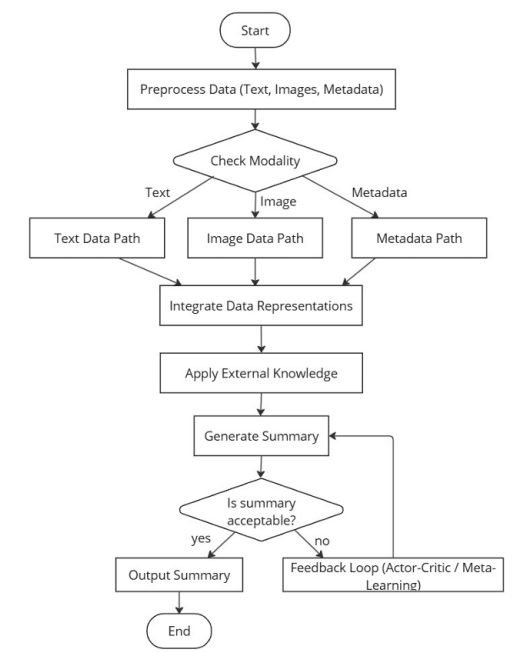
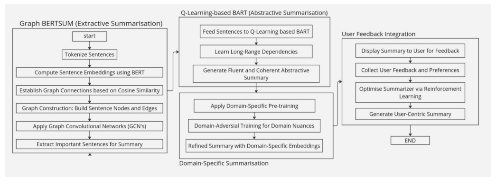

# Phase 2 · Malayalam Headline Generation

We repaired and reran the Malayalam headline-generation code with improvements to independent Transformer layers, padding and EOS supervision, dataset separation, batched decoding, and Unicode-aware evaluation.

The supported experiment trains this repository's **custom encoder–decoder Transformer from scratch** on a deduplicated official-split variant of [AI4Bharat IndicHeadlineGeneration](https://huggingface.co/datasets/ai4bharat/IndicHeadlineGeneration), Malayalam (`ml`). It uses no pretrained model weights. This is a new benchmark experiment, separate from the historical unknown-provenance 89,934-row corpus.

## Results

The rerun trained on **7,212 real articles**, selected epoch **16** using **1,176 validation examples**, and evaluated the frozen checkpoint and Lead-8 baseline on all **1,247 retained test examples**.

| Method | ROUGE-1 F1 | ROUGE-2 F1 | ROUGE-L F1 | Corpus chrF |
| --- | ---: | ---: | ---: | ---: |
| Custom Transformer · greedy | 7.738438 | 2.353682 | 7.600939 | 15.567714 |
| Lead-8 words baseline | **22.068678** | **10.203374** | **20.998934** | **34.695107** |

**The Transformer underperforms the simple baseline on every reported overlap metric.** These are newly measured benchmark results, not evidence of improved summary quality or deployment readiness. Synthetic and tiny-overfit tests verify correctness and are not performance results.

Training stopped after 19 epochs (143.61 seconds). The 8,057,664-parameter model ran on an NVIDIA GeForce RTX 5090 Laptop GPU with CUDA bfloat16 and strict deterministic algorithms. Test teacher-forced token cross-entropy was **5.853228**, reported separately from generated-headline quality. Generation took **12.21 seconds**; 85.565% of predictions terminated with EOS and none were empty. See the [result report and independent checks](reports/indic-ml-v2/README.md), [full-precision metrics](reports/indic-ml-v2/metrics.json), and [frozen protocol](reports/indic-ml-v2/protocol.json).

ROUGE-1/2/L are macro F1 using Unicode letter/mark/number tokens with no English stemming; corpus chrF uses character order 6 and beta 2. All reported overlap metrics use a **0–100** scale. Automatic overlap cannot establish factual correctness or fluency; no fluent-language human review is claimed.

## Methodology

- **Data:** pinned publisher archive, conservatively normalized with Unicode NFC and whitespace only. Digits, Latin names, punctuation and Malayalam combining marks are retained. There is no destructive Malayalam-only filter.
- **Separation:** build transitive connected components of equal normalized article hashes **or** equal nonempty canonical URLs across all official splits. Retain one representative per component with precedence **test > dev > train**, then lowest stable composite identity. IDs are local to a split and are always stored as `(split,id)`. No random resplitting or score-based reference choice is used.
- **Used rows:** 7,212 train, 1,176 validation/dev and 1,247 test, from 10,358/5,388/5,220 publisher rows. Exclusions and differing-title duplicate groups are recorded individually. This cleaned single-reference variant is **not directly comparable to unmodified official benchmark scores**. Exact cleanup does not guarantee event-level or near-duplicate independence.
- **Tokenizer:** 8,000-piece SentencePiece BPE trained on retained **training articles and headlines only**, full character coverage, byte fallback, deterministic order, one tokenizer thread. PAD=0, UNK=1, BOS=2 and EOS=3 are distinct.
- **Model:** width 256, four heads, three independent encoder layers and three independent decoder layers, feed-forward width 512, dropout 0.1. The original custom attention architecture is preserved; attention capture is optional. Sources use at most 256 subword tokens; headline labels use at most 64 including EOS.
- **Training:** seed 42; AdamW, learning rate 3e-4, weight decay 0.01, gradient clipping 1.0; batch 32; CUDA bfloat16; maximum 20 epochs. Validation token-weighted cross-entropy selects the best checkpoint; early stopping uses patience 3/minimum improvement 1e-4. ReduceLROnPlateau uses factor 0.5/patience 1. Only padding labels are ignored, so EOS remains supervised.
- **Generation:** fixed batched greedy decoding, at most 64 new tokens; each sequence stops at its own first EOS. Encoder results are cached. No reference length, reference-selected extract, tuned sampling or alternate decoder selection enters test generation.
- **Baseline:** the first **8 whitespace words** of the input article. Eight is the rounded median retained training headline length, fixed before evaluation. A baseline winning is a valid outcome.

The 256-token source cap truncates approximately 78% of training/test articles; full split-specific rates are recorded in the prepared manifest. These are headline-generation results from truncated article inputs, not full-document or multimodal summaries. Test teacher-forced cross-entropy is reported separately from generated-headline overlap.

## Reproduce

The supported environment uses Python 3.12 and CUDA-enabled PyTorch 2.11.0. Install the appropriate PyTorch wheel explicitly before the remaining pinned dependencies:

```text
python -m venv .venv
# Activate the environment for your shell.
python -m pip install torch==2.11.0 --index-url https://download.pytorch.org/whl/cu128
python -m pip install -r requirements.in
python -m pytest -q
```

The measured runtime records the exact Python, PyTorch/CUDA/cuDNN, GPU, precision, seeds and deterministic settings. Reproducibility is scoped to the documented environment; bit-identical results across hardware or dependency versions are not promised.

Download the [publisher archive at the pinned revision](https://huggingface.co/datasets/ai4bharat/IndicHeadlineGeneration/resolve/d9845634dc0f9cb48d4a26c9f6d8986fb87d2027/data/ml_IndicHeadlineGeneration_v1.0.zip) separately. Its SHA-256 must be `1c371ca6a152238aa6419cb334e70f58d36cd31a1a7a12ef59909ada243fcaa6`. Training/imports never download data or models. From the repository root, use fresh output directories:

```text
python preprocess.py --archive /path/to/ml_IndicHeadlineGeneration_v1.0.zip --output-dir prepared/indic-ml-v1
python train.py --prepared-dir prepared/indic-ml-v1 --output-dir outputs/train-v1 --device cuda --precision bfloat16
python evaluate.py --prepared-dir prepared/indic-ml-v1 --run-dir outputs/train-v1 --output-dir outputs/test-v1 --device cuda
```

An optional training-only compute pilot uses `--pilot-steps 40` and a separate output directory; its weights are discarded. The measured run starts fresh. To resume an interrupted run, repeat the same training command with `--resume outputs/train-v1/last.pt`. Dataset/tokenizer/protocol/source identities must match. Resuming is recorded through the existing checkpoints/history; it is not a new model-selection round.

```text
python evaluate.py --recompute-predictions outputs/test-v1/test_predictions.jsonl --output-dir outputs/recomputed
python test.py --prepared-dir prepared/indic-ml-v1 --checkpoint outputs/train-v1/best.pt --article-file article.txt --device cuda
```

Inference uses the same model, tokenizer, frozen precision and greedy generation path as evaluation. Sources/requirements are snapshotted and hashed before training; checkpoint loading rejects changed dataset/tokenizer/split or source-code hashes. Git attributes preserve LF source/evidence bytes across checkouts.

## Evidence and scope

Preparation writes a per-record retained/excluded manifest, aggregate audit, exact split files, train-only tokenizer, token caches and checksums. Training writes the frozen protocol/source bundle, token-weighted epoch history, resumable last checkpoint, best checkpoint and a selection record **before test evaluation**. Evaluation writes one generated/reference/baseline record for every retained test identity, per-example ROUGE, full aggregate metrics, independent saved-file recomputation, termination/length diagnostics and deterministic examples selected by identity order.

Large corpus-derived files, tokenizer/checkpoint binaries and full predictions stay local/ignored. Small aggregate evidence and deterministic examples may be stored in the private repository with dataset attribution. The historical `data/dataset-manifest.json` describes the earlier excluded corpus only; the new publisher benchmark is documented separately in [data/README.md](data/README.md).

The benchmark is distributed under **CC-BY-NC-4.0** according to the [publisher dataset card](https://huggingface.co/datasets/ai4bharat/IndicHeadlineGeneration); preserve attribution and its noncommercial limitation. See also the [IndicNLG suite](https://indicnlp.ai4bharat.org/indicnlg-suite/). No redistribution rights are asserted for the historical corpus.

## Research proposal and repository

The broader January 2025 proposal explored multimodal, multi-document summaries, external knowledge, graphs and feedback. Those remain proposal components; this implementation is text-only Malayalam article-to-headline generation.





[Proposal scope](docs/PROPOSAL.md), [technical notes](docs/TECHNICAL_NOTES.md), and [external literature notes](docs/LITERATURE_NOTES.md) retain that historical context. Literature scores are not this project's results. The unrelated Turkish exploration notebook is unchanged.

| File | Purpose |
| --- | --- |
| `preprocess.py` | Publisher split audit, transitive duplicate cleanup, training-only tokenizer and caches |
| `model.py` | Independent custom Transformer layers, boolean masks, EOS-safe generation |
| `train.py` | Import-safe deterministic training/pilot/resume and validation-only checkpoint selection |
| `evaluate.py` | Frozen held-out evaluation, Unicode ROUGE, corpus chrF, baseline and saved-file recomputation |
| `test.py` | Single-article inference through the shared model/decoder |
| `tests/` | Layer/gradient, masking/EOS, split independence, metric and actual-model integration checks |
